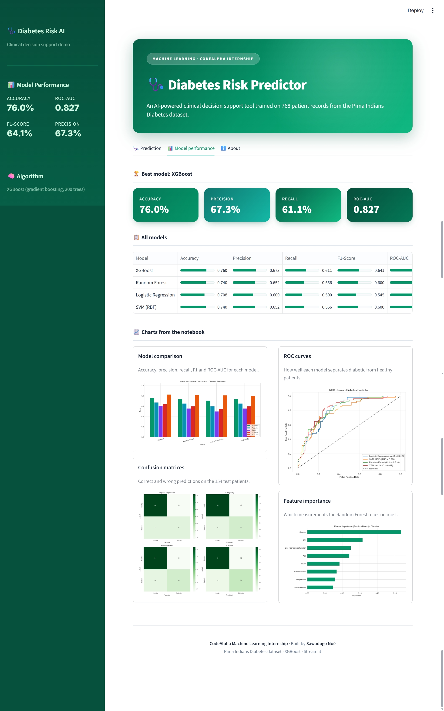
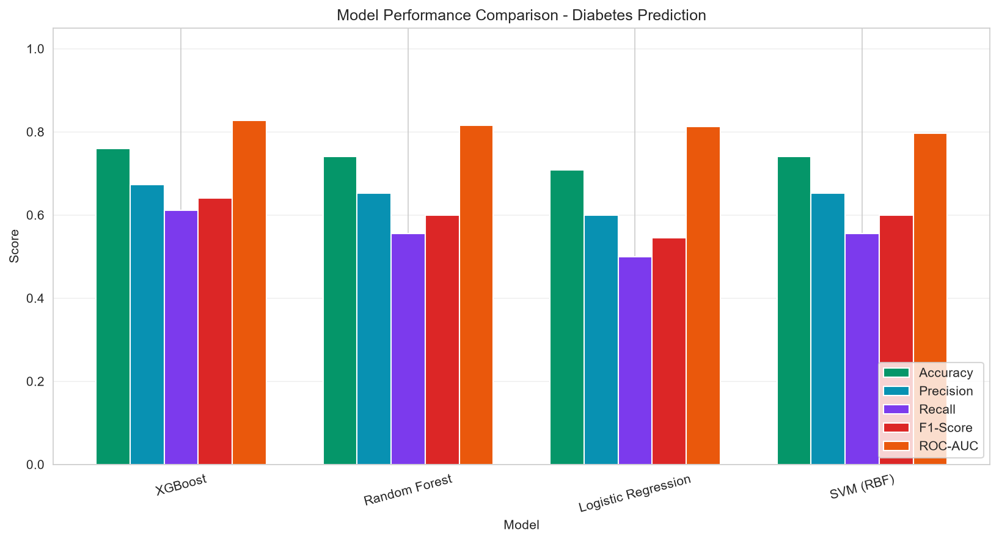
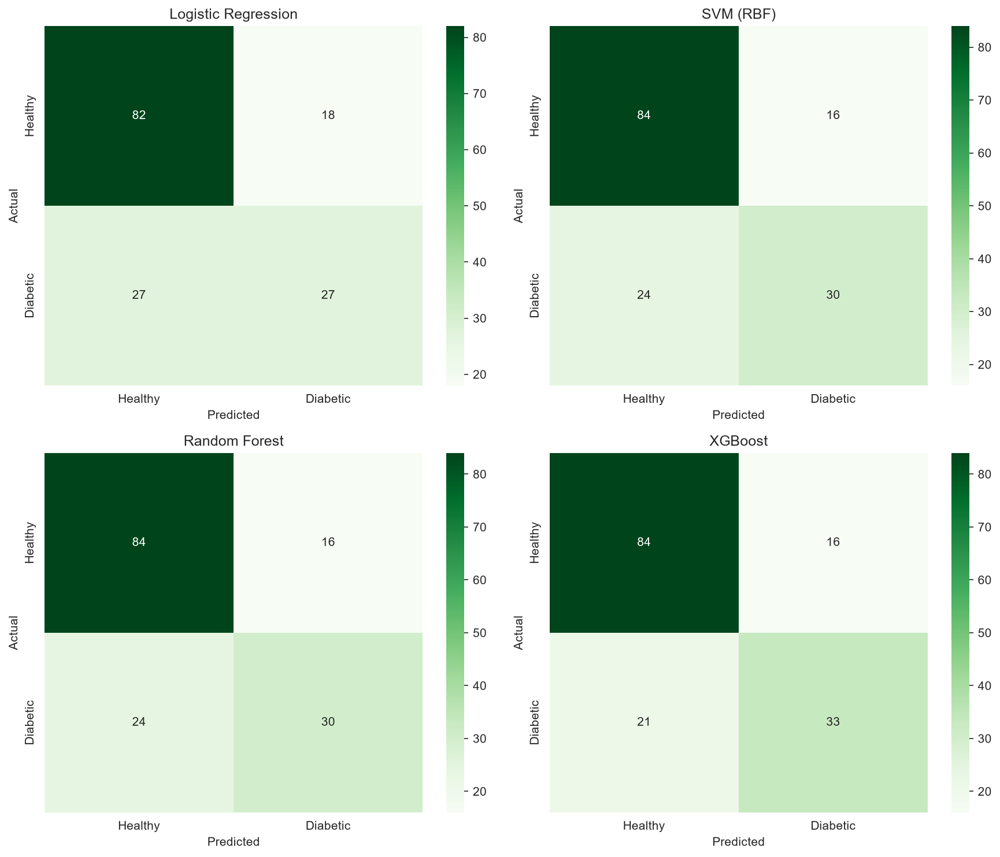
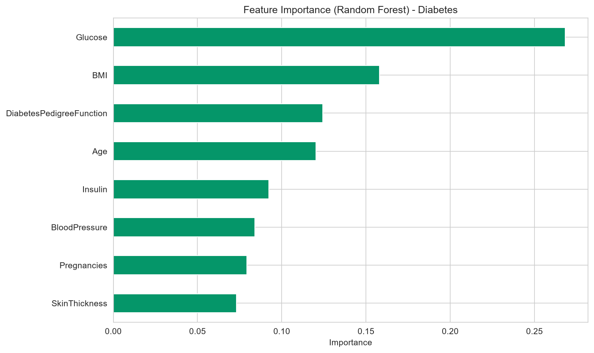
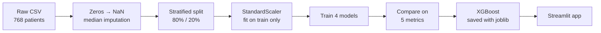

<div align="center">

# 🩺 Diabetes Risk Predictor

**An end-to-end machine learning project that estimates diabetes risk from routine clinical measurements, deployed as an interactive web app.**

[](https://www.python.org/)
[](https://scikit-learn.org/)
[](https://xgboost.readthedocs.io/)
[](https://streamlit.io/)
[](LICENSE)

[**🚀 Live demo**](https://sawadogo-diabetes.streamlit.app) · [**📓 Notebook**](diabetes_prediction.ipynb) · [**💼 LinkedIn**](https://www.linkedin.com/in/ingenieur-ia/)

<sub>CodeAlpha Machine Learning Internship · <b>Task 4: Disease Prediction from Medical Data</b></sub>

<br>

<table>
  <tr>
    <td width="50%" align="center"><b>🩺 Prediction</b><br></td>
    <td width="50%" align="center"><b>📊 Model performance</b><br></td>
  </tr>
</table>

</div>

---

## 📑 Table of contents

- [Overview](#-overview)
- [The app](#-the-app)
- [Results](#-results)
- [Visualizations](#%EF%B8%8F-visualizations)
- [Dataset](#-dataset)
- [Model pipeline](#-model-pipeline)
- [Run locally](#-run-locally)
- [Project structure](#-project-structure)
- [Limitations and future work](#-limitations-and-future-work)
- [Author](#-author)

---

## 📖 Overview

Diabetes affects hundreds of millions of people worldwide, and early detection makes a real difference. This project predicts whether a patient is likely to have diabetes from **8 routine clinical measurements**, such as glucose level, body mass index, age and family history.

Four classification models were trained and compared:

| Model | Type |
|---|---|
| Logistic Regression | Linear baseline |
| Support Vector Machine (RBF kernel) | Kernel method |
| Random Forest | Bagging ensemble |
| **XGBoost** ⭐ | Gradient boosting (selected) |

**Highlights**

- ✅ Detection and imputation of **hidden missing values** (zeros that are not real zeros)
- ✅ Model comparison on **5 metrics**, not accuracy alone
- ✅ Honest evaluation with a clear discussion of limitations
- ✅ Deployed on **Streamlit Community Cloud**

---

## 💻 The app

👉 **[Try it live](https://sawadogo-diabetes.streamlit.app)**

| Tab | What it shows |
|---|---|
| 🩺 **Prediction** | Enter the patient's measurements and get a risk gauge (low, moderate, high), advice, and a chart placing the patient between typical healthy and typical diabetic patients |
| 📊 **Model performance** | Scores of the best model, a comparison table of all four models, and the charts from the notebook |
| ℹ️ **About** | How the model works, how the data was cleaned, and its limitations |

Slider ranges match the training data (for example, no zero insulin or skinfold values), so the model is never asked to predict on values it has never seen.

---

## 📊 Results

Evaluated on a stratified hold-out test set of **154 patients**.

| Model | Accuracy | Precision | Recall | F1-Score | ROC-AUC |
|---|:---:|:---:|:---:|:---:|:---:|
| **XGBoost** ⭐ | **0.760** | **0.673** | **0.611** | **0.641** | **0.827** |
| Random Forest | 0.740 | 0.652 | 0.556 | 0.600 | 0.816 |
| Logistic Regression | 0.708 | 0.600 | 0.500 | 0.545 | 0.813 |
| SVM (RBF) | 0.740 | 0.652 | 0.556 | 0.600 | 0.796 |

> [!NOTE]
> **Why XGBoost?** It has the best ROC-AUC (0.827) and the best F1-Score (0.641), the best balance between missed diabetic patients and false alarms.

### 🔬 Key insights: feature importance (Random Forest)

| Rank | Feature | Importance | Meaning |
|:---:|---|:---:|---|
| 1 | **Glucose** | **26.8%** | Blood sugar 2 hours after an oral glucose test, the strongest predictor |
| 2 | **Body mass index (BMI)** | 15.8% | Weight relative to height |
| 3 | Family history of diabetes (DPF) | 12.4% | Genetic risk score based on relatives with diabetes |
| 4 | Age | 12.0% | Patient age |
| 5 | Insulin | 9.2% | Insulin level 2 hours after the glucose test |

Glucose, BMI, age and family history are well-known risk factors for type 2 diabetes, so the model learned medically sensible patterns.

> [!TIP]
> These importances come from the **Random Forest**. The deployed app uses **XGBoost**, whose ranking can differ slightly. Nearly half of the insulin values were imputed, so its importance should be read with care.

---

## 🖼️ Visualizations

<table>
  <tr>
    <td width="50%"><b>Model comparison</b><br></td>
    <td width="50%"><b>ROC curves</b><br></td>
  </tr>
  <tr>
    <td width="50%"><b>Confusion matrices</b><br></td>
    <td width="50%"><b>Feature importance</b><br></td>
  </tr>
</table>

---

## 📁 Dataset

**[Pima Indians Diabetes](https://archive.ics.uci.edu/)** (UCI Machine Learning Repository, originally from the National Institute of Diabetes and Digestive and Kidney Diseases)

- **768 female patients** of Pima Indian heritage, aged 21 or older
- **Target**: 0 = no diabetes, 1 = diabetes
- **Class balance**: 65.1% healthy (500) / 34.9% diabetic (268)

| Feature | Description | Unit |
|---|---|---|
| Pregnancies | Number of pregnancies | count |
| Glucose | Plasma glucose 2 hours after an oral glucose tolerance test | mg/dL |
| BloodPressure | Diastolic blood pressure | mm Hg |
| SkinThickness | Triceps skinfold thickness, an estimate of body fat | mm |
| Insulin | 2-hour serum insulin | µU/mL |
| BMI | Body mass index | kg/m² |
| DiabetesPedigreeFunction | Family history of diabetes score (DPF) | score |
| Age | Age | years |

### Challenges addressed

| Challenge | Solution |
|---|---|
| **Hidden missing values**: zeros in `Glucose`, `BloodPressure`, `SkinThickness`, `Insulin` and `BMI` are impossible values (up to **48.7%** of `Insulin` and **29.6%** of `SkinThickness`) | Replaced by `NaN`, then imputed with the median |
| **Class imbalance** (65 / 35) | Models compared mainly on F1-Score and ROC-AUC rather than accuracy |
| **Small dataset** (768 patients) | Stratified train/test split to keep the class ratio |

---

## 🧠 Model pipeline



---

## 🚀 Run locally

```bash
# 1. Clone the repository
git clone https://github.com/Sawadogo-cmk/CodeAlpha_DiabetesPrediction.git
cd CodeAlpha_DiabetesPrediction

# 2. Create and activate a virtual environment
python -m venv .venv
.venv\Scripts\activate          # Windows
source .venv/bin/activate       # macOS / Linux

# 3. Install dependencies
pip install -r requirements.txt

# 4. Launch the app (opens at http://localhost:8501)
streamlit run app.py

# 5. (Optional) Explore the notebook
jupyter notebook diabetes_prediction.ipynb
```

---

## 📂 Project structure

```text
CodeAlpha_DiabetesPrediction/
├── .streamlit/
│   └── config.toml                # App theme
├── data/
│   └── diabetes.csv               # Raw dataset (768 patients)
├── images/                        # Charts and app screenshot
│   ├── app_preview_1.png          # Prediction tab
│   ├── app_preview_2.png          # Model performance tab
│   ├── model_comparison.png
│   ├── roc_curves.png
│   ├── confusion_matrices.png
│   └── feature_importance.png
├── app.py                         # Streamlit web application
├── diabetes_prediction.ipynb      # Full analysis and training notebook
├── model.pkl                      # Trained XGBoost model
├── scaler.pkl                     # Fitted StandardScaler
├── features.pkl                   # Feature order expected by the model
├── results.csv                    # Model comparison table
├── requirements.txt
├── LICENSE
└── README.md
```

---

## 🎯 Limitations and future work

**Limitations**

- Metrics come from a **single 80/20 split**: the test set has only 154 patients (about 54 diabetic), so a difference of 2 or 3 patients moves the scores noticeably.
- A recall of 61% means **about 4 in 10 diabetic patients are missed** at the default threshold.
- All patients come from **one population** (Pima women aged 21+), so results may not generalize to other groups.
- Median imputation was computed on the full dataset before the split, which leaks a small amount of information from the test set.

**Future improvements**

- 🔁 **K-fold cross-validation** for more robust estimates and a fairer model comparison
- 🧱 **scikit-learn `Pipeline`** so imputation and scaling are fit on training data only
- 🔬 **Class weighting and decision-threshold tuning** to catch more diabetic patients
- ⚙️ **Hyperparameter tuning** with Optuna
- 📈 **Probability calibration** so risk scores can be read as true probabilities
- 🧪 **External validation** on other datasets (NHANES, Framingham)

---

## ⚠️ Disclaimer

This is a machine learning demonstration project, **not a medical device**. Its predictions must never replace professional medical advice. Always consult a qualified physician for diabetes screening.

---

## 👨‍💻 Author

<table>
  <tr>
    <td>
      <b>Sawadogo Noé</b><br>
      Machine Learning Intern at CodeAlpha<br><br>
      <a href="https://www.linkedin.com/in/ingenieur-ia/"></a>
      <a href="https://github.com/Sawadogo-cmk"></a>
      <a href="https://sawadogo-diabetes.streamlit.app"></a>
    </td>
  </tr>
</table>

### 🙏 Acknowledgements

- **[CodeAlpha](https://www.codealpha.tech)** for the internship program
- **UCI Machine Learning Repository** and the **National Institute of Diabetes and Digestive and Kidney Diseases** for the dataset
- Original study: Smith, J.W., Everhart, J.E., Dickson, W.C., Knowler, W.C., & Johannes, R.S. (1988). *Using the ADAP learning algorithm to forecast the onset of diabetes mellitus.*

---

<div align="center">

📜 Licensed under the [MIT License](LICENSE)

<sub>Built with 🩺 and 🐍 during the CodeAlpha Machine Learning Internship</sub>

</div>
