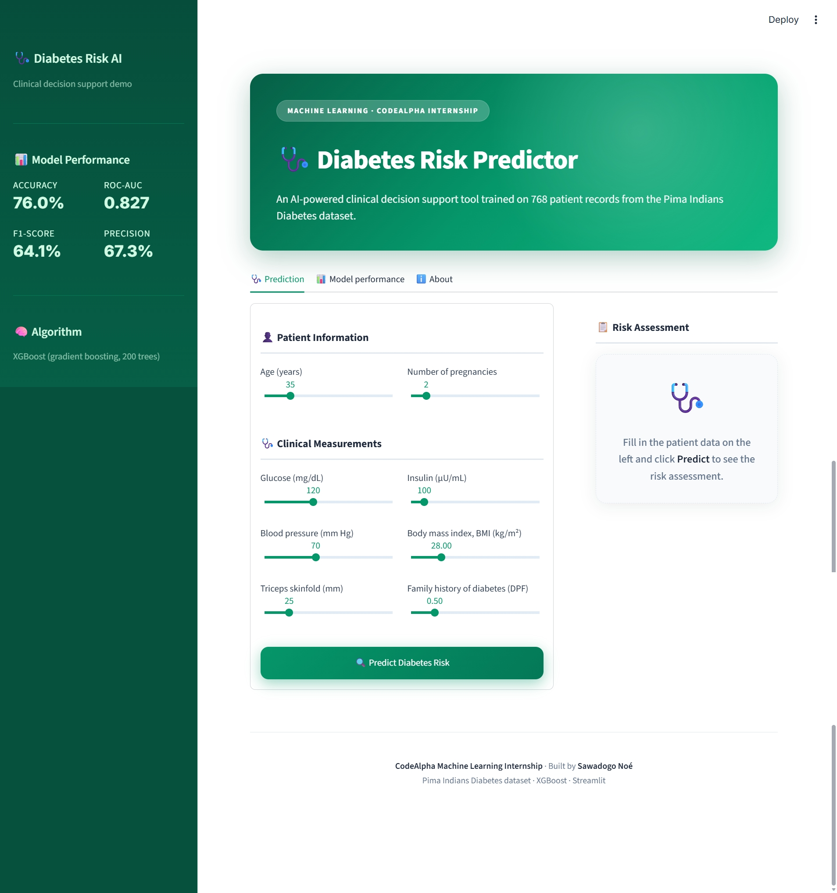
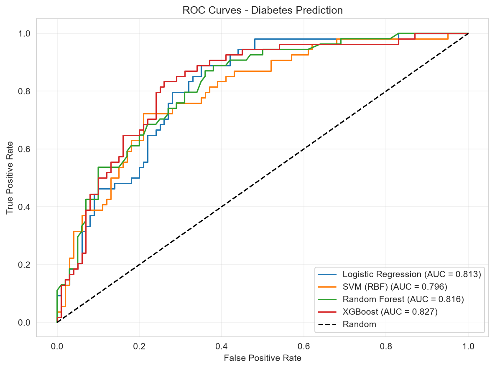

<div align="center">

# 🩺 Diabetes Risk Predictor

**An end-to-end machine learning project that estimates diabetes risk from routine clinical measurements, with a live interactive web app.**

[](https://www.python.org/)
[](https://scikit-learn.org/)
[](https://xgboost.readthedocs.io/)
[](https://streamlit.io/)
[](LICENSE)

**[🚀 Try the live app](https://sawadogo-diabetes.streamlit.app)**

*CodeAlpha Machine Learning Internship · Task 4: Disease Prediction from Medical Data*

</div>

---

## 📸 App Preview



The app has three tabs:

- **🩺 Prediction**: enter the patient's measurements and get a risk gauge (low, moderate or high), advice, and a chart comparing the patient with typical healthy and diabetic patients.
- **📊 Model performance**: scores of the best model, a comparison of all four models, and the charts from the notebook.
- **ℹ️ About**: how the model works, how the data was cleaned, and its limitations.

---

## 📖 Overview

Diabetes affects hundreds of millions of people worldwide, and early detection makes a real difference. This project predicts whether a patient is likely to have diabetes from **8 routine clinical measurements** such as glucose, body mass index, age and family history.

Four classification models were trained and compared:

- **Logistic Regression**
- **Support Vector Machine (RBF kernel)**
- **Random Forest**
- **XGBoost** ⭐ (selected)

---

## 📊 Results

Evaluated on a stratified test set of **154 patients**.

| Model | Accuracy | Precision | Recall | F1-Score | ROC-AUC |
|---|:---:|:---:|:---:|:---:|:---:|
| **XGBoost** ⭐ | **0.760** | **0.673** | **0.611** | **0.641** | **0.827** |
| Random Forest | 0.740 | 0.652 | 0.556 | 0.600 | 0.816 |
| Logistic Regression | 0.708 | 0.600 | 0.500 | 0.545 | 0.813 |
| SVM (RBF) | 0.740 | 0.652 | 0.556 | 0.600 | 0.796 |

**XGBoost** was selected because it has the best ROC-AUC (0.827) and the best F1-Score (0.641), the best balance between missed diabetic patients and false alarms.

### Model comparison


### ROC curves

The closer a curve gets to the top-left corner, the better the model separates diabetic from healthy patients.



### Confusion matrices

Correct and wrong predictions of each model on the 154 test patients.


---

## 🔬 Feature Importance


| Rank | Feature | Importance | Meaning |
|:---:|---|:---:|---|
| 1 | **Glucose** | **26.8%** | Blood sugar 2 hours after a glucose test, the strongest predictor |
| 2 | **Body mass index (BMI)** | 15.8% | Weight relative to height |
| 3 | Family history of diabetes (DPF) | 12.4% | Score based on relatives with diabetes |
| 4 | Age | 12.0% | Patient age |
| 5 | Insulin | 9.2% | Insulin level 2 hours after the glucose test |

Glucose, BMI, age and family history are well-known risk factors for type 2 diabetes, so the model learned medically sensible patterns.

*These importances come from the Random Forest. The app uses XGBoost, whose ranking can differ slightly. Nearly half of the insulin values were imputed, so its importance should be read with care.*

---

## 📁 Dataset

**Pima Indians Diabetes** (UCI Machine Learning Repository, from the National Institute of Diabetes and Digestive and Kidney Diseases)

- **768 female patients** of Pima Indian heritage, aged 21 or older
- **Target**: 0 = no diabetes, 1 = diabetes
- **Class balance**: 65.1% healthy (500) / 34.9% diabetic (268)

| Feature | Description | Unit |
|---|---|---|
| Pregnancies | Number of pregnancies | count |
| Glucose | Plasma glucose 2 hours after an oral glucose test | mg/dL |
| BloodPressure | Diastolic blood pressure | mm Hg |
| SkinThickness | Triceps skinfold thickness (estimate of body fat) | mm |
| Insulin | 2-hour serum insulin | µU/mL |
| BMI | Body mass index | kg/m² |
| DiabetesPedigreeFunction | Family history of diabetes score (DPF) | score |
| Age | Age | years |

### Challenges addressed

- **Hidden missing values**: zeros in `Glucose`, `BloodPressure`, `SkinThickness`, `Insulin` and `BMI` are impossible values, not real measurements (up to **48.7%** of `Insulin` and **29.6%** of `SkinThickness`). They were replaced by `NaN`, then imputed with the median.
- **Class imbalance**: with a 65/35 split, accuracy alone is misleading, so models were compared mainly on F1-Score and ROC-AUC.
- **Small dataset**: only 768 patients, so the train/test split is stratified to keep the class ratio.

---

## 🧠 Model Pipeline

1. **Load** the raw CSV and name the columns
2. **Clean**: replace impossible zeros with `NaN`, then impute with the median
3. **Split**: 80% train / 20% test, stratified
4. **Scale**: `StandardScaler` fitted on the training data only
5. **Train** four models and compare them on five metrics
6. **Select** XGBoost (best ROC-AUC and F1-Score)
7. **Deploy**: save with `joblib` and serve with Streamlit

---

## 🛠️ Tech Stack

| Layer | Tools |
|---|---|
| **Language** | Python 3.13 |
| **Machine learning** | scikit-learn, XGBoost |
| **Data** | pandas, NumPy |
| **Visualization** | Matplotlib, Seaborn |
| **Web app** | Streamlit |
| **Deployment** | Streamlit Community Cloud |

---

## 🚀 Run Locally

```bash
# 1. Clone the repository
git clone https://github.com/Sawadogo-cmk/CodeAlpha_DiabetesPrediction.git
cd CodeAlpha_DiabetesPrediction

# 2. Create and activate a virtual environment
python -m venv .venv
.venv\Scripts\activate          # Windows
source .venv/bin/activate       # macOS / Linux

# 3. Install the dependencies
pip install -r requirements.txt

# 4. Launch the app (opens at http://localhost:8501)
streamlit run app.py
```

To explore the full analysis, open `diabetes_prediction.ipynb` with Jupyter.

---

## 📂 Project Structure

```text
CodeAlpha_DiabetesPrediction/
├── .streamlit/
│   └── config.toml                # App theme
├── data/
│   └── diabetes.csv               # Raw dataset (768 patients)
├── images/
│   ├── app_preview.png            # App screenshot
│   ├── model_comparison.png
│   ├── roc_curves.png
│   ├── confusion_matrices.png
│   └── feature_importance.png
├── app.py                         # Streamlit web app
├── diabetes_prediction.ipynb      # Analysis and training notebook
├── model.pkl                      # Trained XGBoost model
├── scaler.pkl                     # Fitted StandardScaler
├── features.pkl                   # Feature order expected by the model
├── results.csv                    # Model comparison table
├── requirements.txt
├── LICENSE
└── README.md
```

---

## ⚠️ Limitations

- Metrics come from a **single 80/20 split**: the test set has only 154 patients (about 54 diabetic), so 2 or 3 patients can move the scores noticeably.
- A recall of 61% means **about 4 in 10 diabetic patients are missed** at the default threshold.
- All patients come from **one population** (Pima women aged 21+), so results may not apply to other groups.
- The median used for imputation was computed on the full dataset before the split, which leaks a little information from the test set.

## 🎯 Future Improvements

- 🔁 **K-fold cross-validation** for more reliable scores
- 🧱 **scikit-learn `Pipeline`** so imputation and scaling are fitted on training data only
- 🔬 **Class weighting and threshold tuning** to catch more diabetic patients
- ⚙️ **Hyperparameter tuning** with Optuna
- 📈 **Probability calibration** so risk scores can be read as true probabilities

---

## ⚠️ Disclaimer

This is a machine learning demonstration project, **not a medical device**. Its predictions must never replace professional medical advice. Always consult a qualified physician for diabetes screening.

---

## 👨‍💻 Author

**Sawadogo Noé**, Machine Learning Intern at CodeAlpha

[](https://www.linkedin.com/in/ingenieur-ia/)
[](https://github.com/Sawadogo-cmk)
[](https://sawadogo-diabetes.streamlit.app)

## 🙏 Acknowledgements

- **[CodeAlpha](https://www.codealpha.tech)** for the internship program
- **UCI Machine Learning Repository** and the **National Institute of Diabetes and Digestive and Kidney Diseases** for the dataset
- Original study: Smith, J.W., Everhart, J.E., Dickson, W.C., Knowler, W.C., & Johannes, R.S. (1988)

## 📜 License

This project is licensed under the MIT License. See the [LICENSE](LICENSE) file for details.

<p align="center"><i>Built with 🩺 and 🐍 during the CodeAlpha Machine Learning Internship</i></p>
