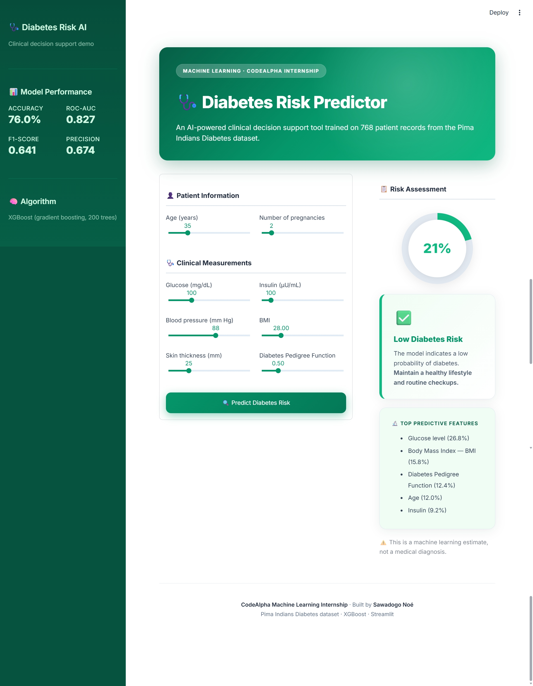
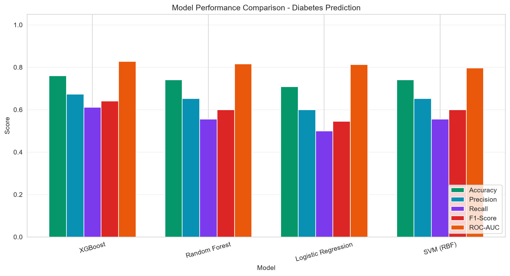
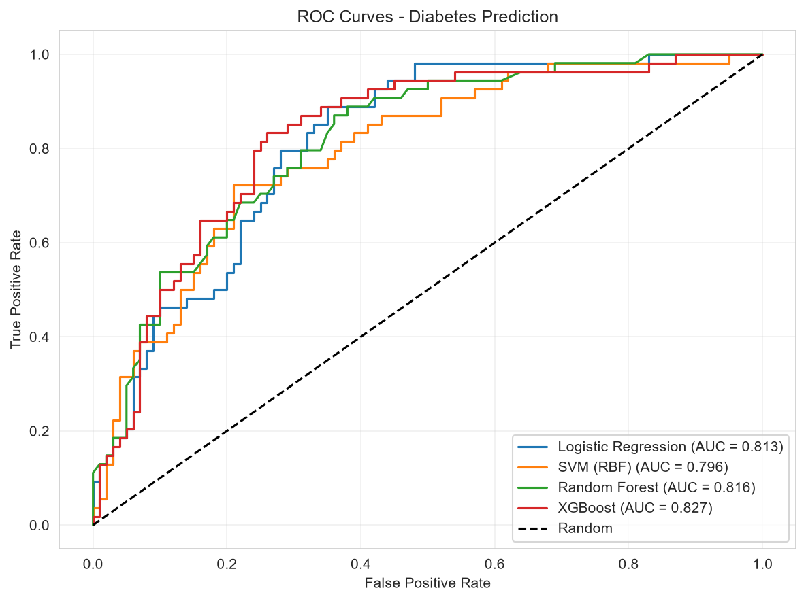
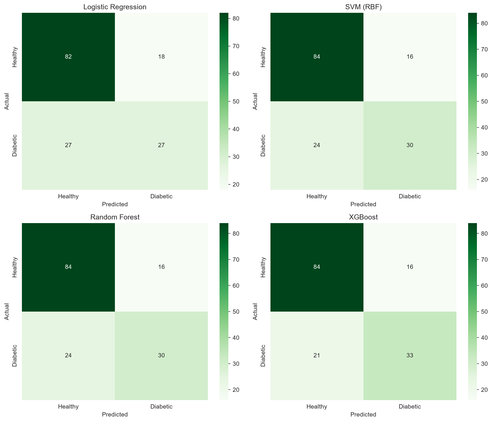
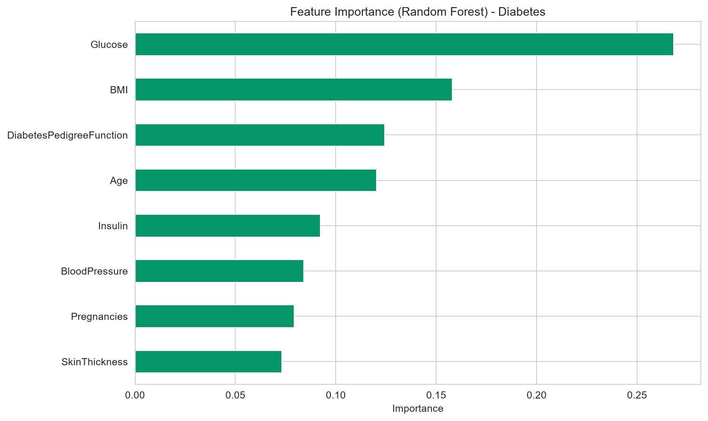

# 🩺 Diabetes Prediction

> An end-to-end Machine Learning project that predicts diabetes risk from clinical measurements, with a live interactive demo.

[](https://www.python.org/)
[](https://scikit-learn.org/)
[](https://xgboost.readthedocs.io/)
[](https://streamlit.io/)
[](LICENSE)

---

## 📸 App Preview



---

## 🚀 Live Demo

👉 **[Try the interactive app here](https://sawadogo-diabetes.streamlit.app)**

Enter a patient's clinical measurements and get an instant diabetes risk assessment powered by an XGBoost model.

---

## 📖 Overview

This project was developed as part of the **Machine Learning Internship at [CodeAlpha](https://www.codealpha.tech)**.

The goal is to predict the onset of diabetes from routine clinical measurements such as glucose level, BMI, age, and insulin, a major public health challenge affecting hundreds of millions of people worldwide.

Four classification models were trained and compared:

- **Logistic Regression**
- **Support Vector Machine (RBF kernel)**
- **Random Forest**
- **XGBoost**

---

## 📊 Results

| Model | Accuracy | Precision | Recall | F1-Score | ROC-AUC |
|---|---|---|---|---|---|
| **XGBoost** ⭐ | **0.7597** | **0.6735** | **0.6111** | **0.6408** | **0.8270** |
| Random Forest | 0.7403 | 0.6522 | 0.5556 | 0.6000 | 0.8161 |
| Logistic Regression | 0.7078 | 0.6000 | 0.5000 | 0.5455 | 0.8130 |
| SVM (RBF) | 0.7403 | 0.6522 | 0.5556 | 0.6000 | 0.7963 |

> ⭐ **XGBoost** was selected as the final model because it has the best ROC-AUC (0.827) and the highest F1-Score (0.641), a good balance between false positives and false negatives.

> ℹ️ **Limitations:** metrics come from a single stratified 80/20 split, so the test set contains only 154 patients (about 54 diabetic). A difference of 2 to 3 patients moves these numbers noticeably, so the ranking between the top models should be read with caution. Recall of 61% also means roughly 4 in 10 diabetic patients are missed at the default threshold, which is why threshold tuning and class weighting are listed in [Future Improvements](#-future-improvements).

### Key Insights: Feature Importance

| Feature | Importance | Meaning |
|---|---|---|
| **Glucose** | **26.8%** | Blood sugar level (the strongest predictor) |
| **BMI** | 15.8% | Body Mass Index |
| Diabetes Pedigree Function | 12.4% | Family history of diabetes |
| Age | 12.0% | Patient age |
| Insulin | 9.2% | Insulin level |

Glucose, BMI, age and family history are consistent with well-known type 2 diabetes risk factors. Note that nearly half of the `Insulin` values were imputed, so its importance should be interpreted carefully.

---

## 🖼️ Visualizations

### Model comparison



### ROC curves



### Confusion matrices



### Feature importance



---

## 📁 Dataset

**Pima Indians Diabetes** (UCI ML Repository)

- **768 female patients** of Pima Indian heritage, aged 21 or older
- **8 clinical features**: pregnancies, glucose, blood pressure, skin thickness, insulin, BMI, diabetes pedigree function, age
- **Target**: binary (0 = no diabetes, 1 = diabetes)
- **Class distribution**: 65.1% healthy (500) / 34.9% diabetic (268)

Because all patients come from a single population, results may not generalize to other groups.

### Challenges addressed

- **Hidden missing values**: zeros in `Glucose`, `BloodPressure`, `SkinThickness`, `Insulin`, and `BMI` are **not real zeros** but missing values (up to **48.7%** of `Insulin` and **29.6%** of `SkinThickness`). They were replaced by `NaN` then imputed with the median.
- **Class imbalance**: with a 65/35 split, accuracy alone is misleading, so models were compared mainly on F1-Score and ROC-AUC. No resampling was applied.
- **Small dataset**: 768 patients only, so the train/test split is stratified to keep the class ratio.

---

## 🛠️ Tech Stack

| Layer | Tools |
|---|---|
| **Language** | Python 3.13 |
| **ML** | scikit-learn, XGBoost |
| **Data** | pandas, NumPy |
| **Visualization** | Matplotlib, Seaborn |
| **Web app** | Streamlit |
| **Deployment** | Streamlit Community Cloud |

---

## 📂 Project Structure

```text
CodeAlpha_DiabetesPrediction/
├── .streamlit/
│   └── config.toml                # Light theme with green accent
├── data/
│   └── diabetes.csv               # Raw dataset (768 patients)
├── images/
│   ├── app_preview.png            # Streamlit app screenshot
│   ├── model_comparison.png
│   ├── roc_curves.png
│   ├── confusion_matrices.png
│   └── feature_importance.png
├── app.py                         # Streamlit web application
├── diabetes_prediction.ipynb      # Full ML analysis notebook
├── model.pkl                      # Trained XGBoost model
├── scaler.pkl                     # StandardScaler
├── features.pkl                   # Feature names for alignment
├── results.csv                    # Model comparison table
├── requirements.txt
└── README.md
```

---

## 🚀 Run Locally

### 1. Clone the repository

```bash
git clone https://github.com/Sawadogo-cmk/CodeAlpha_DiabetesPrediction.git
cd CodeAlpha_DiabetesPrediction
```

### 2. Create and activate a virtual environment

```bash
python -m venv .venv

# Windows
.venv\Scripts\activate

# macOS / Linux
source .venv/bin/activate
```

### 3. Install dependencies

```bash
pip install -r requirements.txt
```

### 4. Launch the Streamlit app

```bash
streamlit run app.py
```

The app opens at <http://localhost:8501>.

### 5. (Optional) Explore the notebook

```bash
jupyter notebook diabetes_prediction.ipynb
```

---

## 🧠 Model Pipeline

1. **Data loading**: CSV without header → named columns
2. **Preprocessing**:
   - Replace zeros with `NaN` in `Glucose`, `BloodPressure`, `SkinThickness`, `Insulin`, `BMI`
   - Impute missing values with the median
3. **Split**: 80% train / 20% test (stratified)
4. **Scaling**: `StandardScaler` fit on the training data only
5. **Training**: 4 models compared on 5 metrics
6. **Selection**: XGBoost chosen (best ROC-AUC and F1)
7. **Deployment**: serialized with `joblib`, served via Streamlit

---

## 🎯 Future Improvements

- 🔁 **K-fold cross-validation** for robust estimates and a fairer model comparison
- 🧱 **scikit-learn `Pipeline`** so imputation and scaling are fit on training data only
- 🔬 **Class weighting / SMOTE and decision-threshold tuning** to improve diabetic recall
- ⚙️ **Hyperparameter tuning** with Optuna
- 📈 **Probability calibration** so risk scores can be read as probabilities
- 🌐 **Unified health dashboard** combining Heart Disease and Diabetes predictions
- 🧪 **Additional datasets** (Framingham, NHANES) for broader generalization

---

## ⚠️ Disclaimer

This is a machine learning demonstration project, **not a medical device**. Predictions should never replace professional medical advice. Always consult a qualified physician for diabetes screening.

---

## 👨‍💻 Author

**Sawadogo Noé**, Machine Learning Intern at CodeAlpha

- 🐙 GitHub: [@Sawadogo-cmk](https://github.com/Sawadogo-cmk)
- 💼 LinkedIn: Sawadogo Noé
- 🌐 Live demo: [sawadogo-diabetes.streamlit.app](https://sawadogo-diabetes.streamlit.app)

---

## 🙏 Acknowledgements

- **CodeAlpha** for the internship program
- **UCI ML Repository** and the **National Institute of Diabetes and Digestive and Kidney Diseases** for the dataset
- Original collectors: Smith, J.W., Everhart, J.E., Dickson, W.C., Knowler, W.C., & Johannes, R.S. (1988)

---

## 📜 License

This project is licensed under the MIT License. See the [LICENSE](LICENSE) file for details.

<p align="center"><i>Built with 🩺 and 🐍 during the CodeAlpha Machine Learning Internship</i></p>